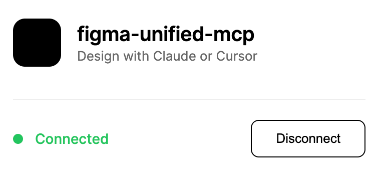
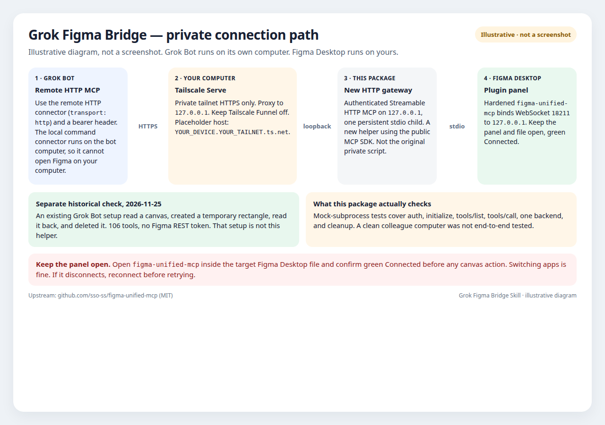
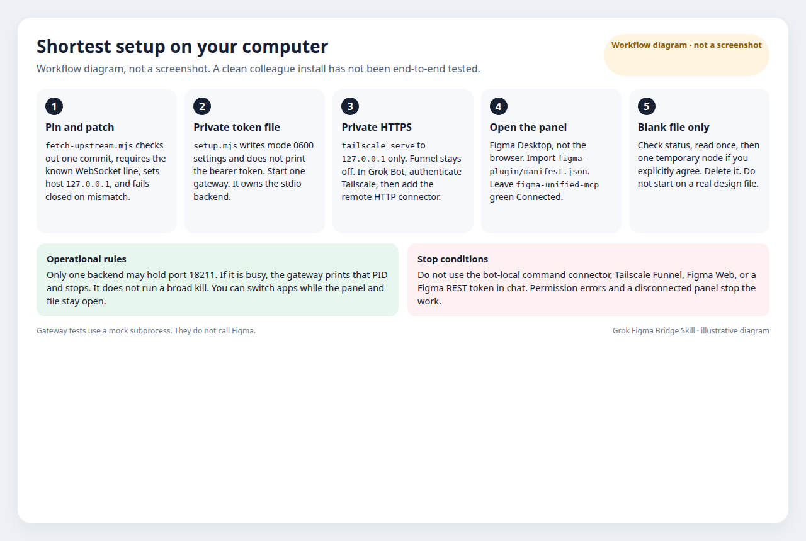

# Grok Figma Bridge Skill

[中文](README.md) | [English](README.en.md)

Connect Grok Bot to Figma Desktop on your own computer through the MIT project [`sso-ss/figma-unified-mcp`](https://github.com/sso-ss/figma-unified-mcp), without setting `FIGMA_ACCESS_TOKEN`.

> **Scope first**
>
> - On 2026-11-25 an existing Grok Bot setup read a canvas, created a temporary rectangle, read it back, and deleted it. 106 tools were available and the REST API was not configured. That setup is not the new helper in this repository.
> - This repository now includes a new local gateway and an upstream fetch/loopback patch that fails closed on mismatch. The gateway uses the public MCP TypeScript SDK. It is not a private script from the original setup.
> - Automated tests talk to a mock stdio subprocess and do not call Figma. In the packaging workspace the pinned upstream commit was patched, built, and listed 106 tools locally, with port `18211` bound to `127.0.0.1` only. No Figma tool was called and no Figma account was used.
> - A clean colleague computer, other clients, and a company tailnet were not tested end to end. Do not describe those as reproduced.
> - Not affiliated with Figma, Inc. The plugin does not replace login or file permissions, and it does not waive Grok Bot usage or Figma plan limits.

## Mandatory notice

> **Before any canvas action, open the `figma-unified-mcp` plugin panel inside the target Figma Desktop file and confirm green `Connected`. Keep the plugin and that file open. Switching applications is fine. If it disconnects, reconnect before retrying.**



*Cropped real panel image. It shows only that the panel was connected when the picture was taken. It has no text metadata. It does not show that a colleague computer is installed.*

## Connection path



*Original diagram, not a screenshot.*

Grok Bot's local command connector executes on the bot's computer, so it cannot reach Figma on yours. The verified connector shape is remote HTTP (`transport: http`) over Tailscale Serve's private HTTPS, into a local authenticated gateway.

The gateway in this package is Streamable HTTP MCP bound to `127.0.0.1`. It compares the bearer token in constant time and uses the SDK Host and Origin checks. It starts one stdio child. That child's environment does not include the gateway token or `FIGMA_ACCESS_TOKEN`.

## Shortest install



*Workflow diagram, not a screenshot.*

You need Node.js 20 or newer (the gateway SDK requires it; upstream's own `package.json` says Node 18+), [Figma Desktop](https://www.figma.com/downloads/) rather than the browser, and [Tailscale](https://tailscale.com/download). Tailscale Serve needs MagicDNS and HTTPS certificates enabled for the tailnet. See the [Tailscale Serve documentation](https://tailscale.com/docs/features/tailscale-serve).

There is no separate Figma Community download URL in the upstream README. The supported install imports the local manifest. The manifest `name` is `figma-unified-mcp`, which matches the cropped panel title. The upstream README also calls the development menu item "Figma Unified MCP Bridge". If the menu shows the manifest name, choose `figma-unified-mcp`.

```bash
npm ci
node scripts/fetch-upstream.mjs
node scripts/setup.mjs \
  --upstream upstream/figma-unified-mcp/dist/server.js \
  --allowed-host YOUR_DEVICE.YOUR_TAILNET.ts.net
node src/gateway.mjs
node scripts/enable-tailscale-serve.mjs
```

`setup.mjs` writes the token to a mode `0600` file and does not print it. The default path is `$XDG_CONFIG_HOME/grok-figma-bridge/gateway.env`, or the same folder under the user config directory. Do not paste the token into chat. Enter `Authorization: Bearer …` in the connector's own credential field.

`fetch-upstream.mjs` accepts only commit `1f089393e73da8a5955bd48b973b3af2ac7def28` from `https://github.com/sso-ss/figma-unified-mcp.git`. It checks the hash of `plugin-bridge.ts` and this line:

`new WebSocketServer({ port: this.port })`

It then sets `host: "127.0.0.1"`. A hash, constructor count, or bundle mismatch stops the script. The checkout lives in gitignored `upstream/`. This repository does not vendor the upstream tree.

`enable-tailscale-serve.mjs` runs only:

```text
tailscale serve --bg --https=443 http://127.0.0.1:3847
```

It refuses arguments that mention Funnel. The command is the one in the [tailscale serve reference](https://tailscale.com/docs/reference/tailscale-cli/serve). Do not run `tailscale funnel`.

### Register it in Grok Bot

1. Open **Connect apps → Your plugins → Tailscale** and choose **Authenticate** for the same tailnet. Adding a tailnet, changing the default, or removing a device shows an allow/deny card. Wait for the user to allow it. Do not install a Tailscale client on the bot computer.
2. Add a remote HTTP MCP server, not a local command. The recorded `AddMcpServer` fields are a name, a URL, and optional headers. A private-network address asks for approval again. The shape is in [`templates/grok-bot-remote-mcp.template.json`](templates/grok-bot-remote-mcp.template.json). The URL is `https://YOUR_DEVICE.YOUR_TAILNET.ts.net/mcp`.
3. On a personal tailnet the member needs to own or administer it. On a company tailnet an admin enables the integration at cursor.com first, then the member authenticates. This package was not tested on a company tailnet.

### Open the plugin in Figma Desktop

1. Open a blank test file you have explicitly authorized.
2. Choose **Plugins → Development → Import plugin from manifest...** and select `figma-plugin/manifest.json` from the checkout.
3. Run `figma-unified-mcp`. The manifest allows only `ws://localhost:18211`. Leave the panel green `Connected` on channel `figma`.
4. The server binds `127.0.0.1` only. If the panel cannot connect while the listener is already `127.0.0.1`, do not bind every interface. Localhost may be using IPv6 `::1`. That case was not tested on a Mac.

## How to tell the checks apart

| Item | Status |
| --- | --- |
| 2026-11-25 read, temporary rectangle, readback, and delete on an existing Grok Bot setup | Happened on that setup. Not a rerun of this helper |
| Auth, initialize, tools/list, tools/call, single instance, and cleanup against a mock subprocess | Tested in this package |
| Pinned upstream patch and build, `127.0.0.1:18211`, local `tools/list` count 106 | Done in the packaging workspace. No Figma tool was called |
| Clean colleague computer, other clients, company tailnet | Not tested |

A read and one temporary write on a blank file still wait for explicit permission. Delete the temporary node before touching a real design file.

## Safety

- HTTP and the plugin WebSocket stay on loopback. The gateway rejects TCP connections whose peer address is not loopback.
- A missing or wrong bearer gets the same `401`. The response does not echo the token. A token in the query string is rejected.
- Host and Origin checks come from `@modelcontextprotocol/node`. Loopback names are allowed, plus extra DNS names in the settings file. `*`, non-loopback IPs, and values with a path are refused.
- If a port is busy, the gateway prints the PID and a short command, then exits. The stop script sends `SIGTERM` only to the PID in the lock file when its command line contains `gateway.mjs`.
- Upstream still contains code that, on `EADDRINUSE`, can stop an older node process on that port. This gateway exits first when `18211` is already taken, so that path should not run. The patch changes only the WebSocket host so a different upstream version fails closed.
- Do not commit secrets. `.gitignore` covers `upstream/`, `.runtime/`, `.env`, and logs.

Troubleshooting and uninstall: [docs/TROUBLESHOOTING.en.md](docs/TROUBLESHOOTING.en.md). Agent-facing usage: [SKILL.md](SKILL.md).

## License

This package is MIT. See [LICENSE](LICENSE). Upstream remains MIT, copyright sso-ss, and its source is not vendored here. The MCP SDK is Apache-2.0 and is installed from npm. See [THIRD_PARTY_NOTICES.md](THIRD_PARTY_NOTICES.md).
