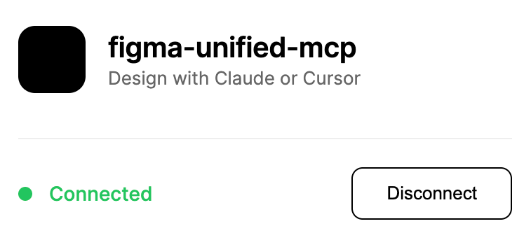
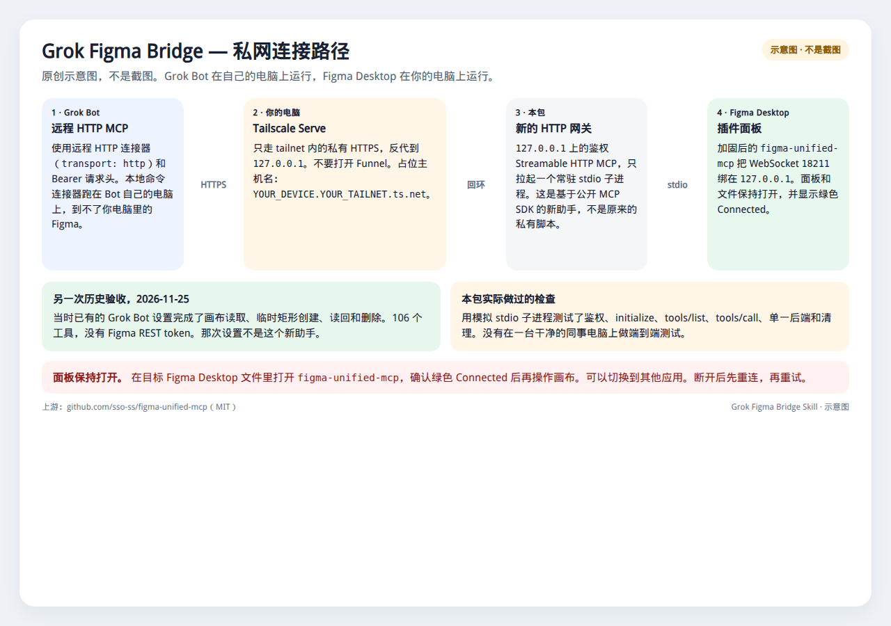
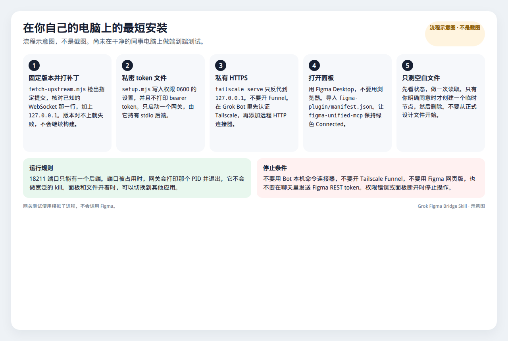

# Grok Figma Bridge Skill

[中文](README.md) | [English](README.en.md)

把 Grok Bot 接到你自己电脑上的 Figma Desktop。路径使用开源的 [`sso-ss/figma-unified-mcp`](https://github.com/sso-ss/figma-unified-mcp)（MIT）插件桥，不配置 `FIGMA_ACCESS_TOKEN`。

> **先看范围**
>
> - 2026-11-25 有一次已经存在的 Grok Bot 设置完成了读取、临时矩形创建、读回和删除。106 个工具，REST API 未配置。那次设置不是本仓库里的新助手。
> - 本仓库现在带有一个新的本地网关，以及会在版本不匹配时失败的上游拉取/回环补丁脚本。网关使用公开的 MCP TypeScript SDK，不是原来那份私有脚本。
> - 自动化测试打的是模拟 stdio 子进程，不调用 Figma。打包环境里对固定上游提交做了本地 `tools/list`（106 个工具）并确认 `18211` 只听在 `127.0.0.1`。没有调用 Figma 工具，也没有 Figma 账号。
> - 干净的同事电脑、其他客户端、公司 tailnet 都没有端到端测试。不能把本包说成已经在那些环境复现。
> - 与 Figma, Inc. 无关。插件不能代替登录或文件权限，也不免除 Grok Bot 用量或 Figma 方案限制。

## 重要提示

> **使用前，在目标 Figma Desktop 文件中打开 `figma-unified-mcp` 插件面板，确认显示绿色 `Connected`。操作期间保持插件和该文件打开；可以切换到其他应用。断开后先重连，再重试。**



*这是裁剪后的真实面板图，只说明截图时面板已连接。它不证明同事电脑已经安装成功。图里没有文字元数据。*

## 连接路径



*原创示意图，不是截图。*

Grok Bot 的本地命令连接器在 Bot 自己的电脑上执行，到不了你电脑上的 Figma。实测形状是远程 HTTP（`transport: http`）经过 Tailscale Serve 的私有 HTTPS，再进本机鉴权网关。

本包的网关是 Streamable HTTP MCP，只绑定 `127.0.0.1`，用常量时间比较 Bearer，并用 SDK 的 Host / Origin 检查。它只拉起一个 stdio 子进程。子进程的环境不包含网关 token，也不包含 `FIGMA_ACCESS_TOKEN`。

## 最短安装



*流程示意图，不是截图。*

需要 Node.js 20 或更新（网关依赖的 SDK 要求如此；上游自己的 `package.json` 写的是 Node 18+）、[Figma Desktop](https://www.figma.com/downloads/)（不要用浏览器），以及 [Tailscale](https://tailscale.com/download)。Tailscale Serve 需要在该 tailnet 打开 MagicDNS 和 HTTPS 证书，见 [Tailscale Serve 文档](https://tailscale.com/docs/features/tailscale-serve)。

插件没有单独的 Figma Community 下载地址。上游 README 的安装方式是导入本地 manifest。manifest 的 `name` 是 `figma-unified-mcp`，和裁剪图里的标题一致。上游 README 也把开发菜单写成 “Figma Unified MCP Bridge”；如果菜单显示的是 manifest 名称，选择 `figma-unified-mcp`。

```bash
npm ci
node scripts/fetch-upstream.mjs
node scripts/setup.mjs \
  --upstream upstream/figma-unified-mcp/dist/server.js \
  --allowed-host YOUR_DEVICE.YOUR_TAILNET.ts.net
node src/gateway.mjs
node scripts/enable-tailscale-serve.mjs
```

`setup.mjs` 把 token 写进模式 `0600` 的文件，并且不打印 token。默认文件在 `$XDG_CONFIG_HOME/grok-figma-bridge/gateway.env`，否则在用户配置目录的 `grok-figma-bridge/gateway.env`。不要把 token 贴进聊天。在连接器自己的凭据栏里填写 `Authorization: Bearer …`。

`fetch-upstream.mjs` 只接受 `https://github.com/sso-ss/figma-unified-mcp.git` 的提交 `1f089393e73da8a5955bd48b973b3af2ac7def28`。它核对 `plugin-bridge.ts` 的哈希和这一行：

`new WebSocketServer({ port: this.port })`

然后改成带 `host: "127.0.0.1"`。哈希、构造次数或打包结果对不上就停止，不会用别的版本继续构建。检出目录在 `upstream/`，已被 git 忽略，仓库不内嵌上游源码。

`enable-tailscale-serve.mjs` 只执行：

```text
tailscale serve --bg --https=443 http://127.0.0.1:3847
```

它拒绝参数里出现 Funnel。官方说明见 [tailscale serve](https://tailscale.com/docs/reference/tailscale-cli/serve)。不要运行 `tailscale funnel`。

### 在 Grok Bot 里登记

1. 打开 **Connect apps → Your plugins → Tailscale**，对同一个 tailnet 点 **Authenticate**。添加 tailnet、改默认 tailnet 或移除设备时会有允许/拒绝卡片，等用户允许。不要在 Bot 电脑上另装 Tailscale 客户端。
2. 添加远程 HTTP MCP，而不是本地命令。`AddMcpServer` 记录的字段是名称、URL 和可选 headers。私网地址会再要一次批准。形状见 [`templates/grok-bot-remote-mcp.template.json`](templates/grok-bot-remote-mcp.template.json)。URL 是 `https://YOUR_DEVICE.YOUR_TAILNET.ts.net/mcp`。
3. 个人 tailnet：成员需要拥有或管理该 tailnet。公司 tailnet：管理员要先在 cursor.com 的 Integrations 里启用，成员再 Authenticate。本包没有在公司 tailnet 上测试。

### 在 Figma Desktop 里打开插件

1. 打开一个你明确授权的空白测试文件。
2. **Plugins → Development → Import plugin from manifest...**，选择检出目录里的 `figma-plugin/manifest.json`。
3. 运行 `figma-unified-mcp`。manifest 只允许 `ws://localhost:18211`。面板保持绿色 `Connected`，频道 `figma`。
4. 服务器只绑 `127.0.0.1`。如果面板连不上，而监听地址已经是 `127.0.0.1`，不要改成所有网卡。这可能是 localhost 走到了 IPv6 `::1`。这一步没有在 Mac 上测试。

## 验收时怎么区分

| 项目 | 状态 |
| --- | --- |
| 2026-11-25 已有 Grok Bot 的读、临时矩形、读回、删除 | 那次设置已发生。不是本助手的复跑 |
| 模拟子进程上的鉴权、initialize、tools/list、tools/call、单实例、清理 | 本包测试 |
| 固定上游提交的补丁、构建、`127.0.0.1:18211`、本地 `tools/list` 为 106 | 打包环境做过。没有调用 Figma 工具 |
| 干净同事电脑、其他客户端、公司 tailnet | 未测试 |

空白文件上的读取和一次临时写入，仍然只在用户明确授权后做。先删掉临时节点，再碰正式文件。

## 安全

- HTTP 和插件 WebSocket 都只在回环地址。网关拒绝非回环来源的 TCP 连接。
- 未带正确 Bearer 的请求返回同一个 `401`，响应里不回显 token。token 不能放在 URL 查询参数里。
- Host 和 Origin 使用 `@modelcontextprotocol/node` 的检查。允许回环名，以及设置文件里的额外 DNS 名。不接受 `*`、非回环 IP，或带路径的值。
- 端口被占用时打印 PID 和命令摘要后退出。停止脚本只给锁文件里、命令行包含 `gateway.mjs` 的那一个 PID 发 `SIGTERM`。
- 上游源码在 `EADDRINUSE` 时仍有一段会结束占用端口的旧 node 进程的逻辑。本网关在启动前发现 `18211` 已被占用就会退出，避免走到那段逻辑。补丁只改 WebSocket 的 host，以免固定版本对不上。
- 不要把密钥写进 git。`.gitignore` 忽略 `upstream/`、`.runtime/`、`.env` 和日志。

故障排查和卸载：[docs/TROUBLESHOOTING.md](docs/TROUBLESHOOTING.md)。给智能体看的用法：[SKILL.md](SKILL.md)。

## 许可

本包是 MIT，见 [LICENSE](LICENSE)。上游仍是 sso-ss 的 MIT，本仓库不内嵌其源码。MCP SDK 是 Apache-2.0，由 npm 安装，见 [THIRD_PARTY_NOTICES.md](THIRD_PARTY_NOTICES.md)。
